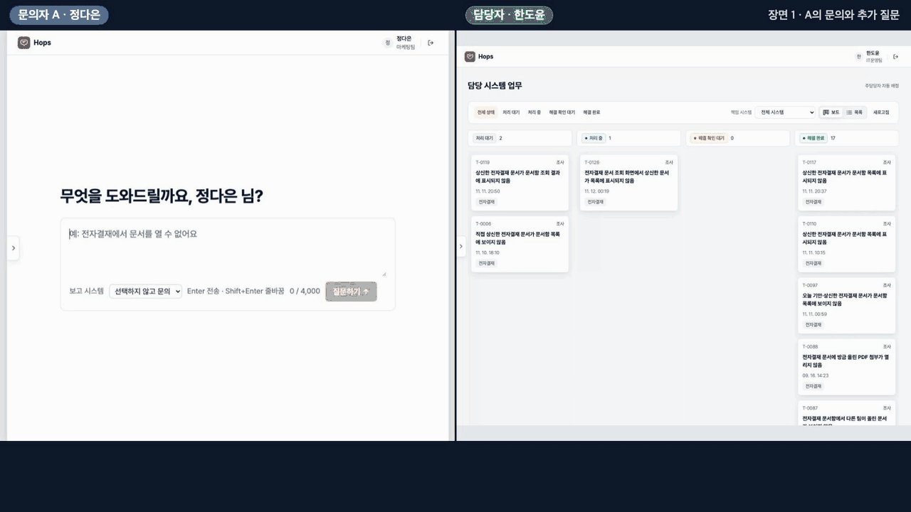
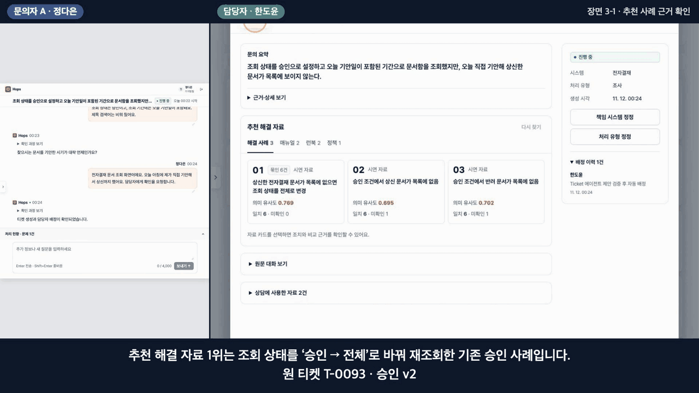
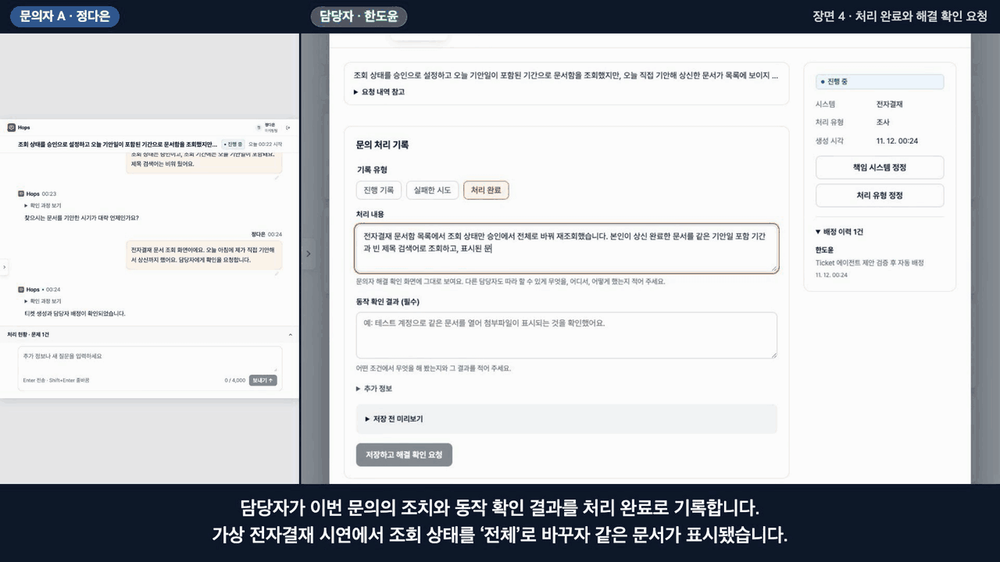
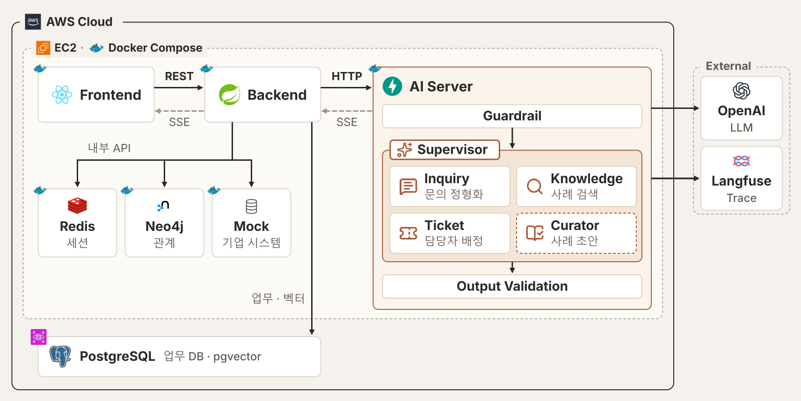
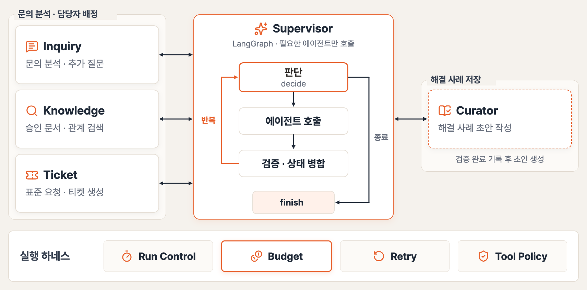

<p align="center">
  <picture>
    <source media="(prefers-color-scheme: dark)" srcset="./docs/images/brand/hops-logo-dark.svg">
    
  </picture>
</p>

<h1 align="center">사내 IT 문의 대응 AI 에이전트</h1>

<p align="center">
  <strong>대화형 문의 분석 · 담당자 자동 배정 · 승인된 해결 사례 재사용</strong><br>
  자연어 문의를 정리하고 담당자에게 연결하며, 승인된 해결 사례를 다음 업무에 활용합니다.
</p>

<p align="center">
  <a href="https://github.com/Hi-Hops/Hops">GitHub</a> ·
  <a href="https://hi-hops.duckdns.org">서비스 접속</a> ·
  <a href="https://hi-hops.duckdns.org/swagger-ui/index.html">Swagger</a> ·
  <a href="#getting-started">로컬 Mock 체험</a>
</p>

<p align="center">
  
  
  
  
  
  
  
  
</p>

<a id="demo"></a>

## 🎬 시연

**자연어 문의 → 추가 질문 → 티켓 생성·담당자 배정**



녹화 시연을 약 5배속으로 재생합니다. 아래에서 담당자 처리와 사례 승인 흐름도 확인할 수 있습니다.

<details>
<summary><strong>추천 근거를 확인하고 업무 처리하기</strong></summary>



문의와 사례의 원문, 의미 유사도, 적용 조건을 대조하고 조치·검증 결과를 기록합니다.

</details>

<details>
<summary><strong>해결 확인부터 사례 승인·검색 반영까지</strong></summary>



문의자의 해결 확인 후 사례를 검토·승인하고, Vector·Neo4j의 반영 상태를 확인합니다.

</details>

**목차** · [프로젝트 소개](#overview) · [팀원 및 역할](#team) · [주요 기능](#features) · [기술 스택](#stack) · [아키텍처](#architecture) · [API 명세](#api) · [시작하기](#getting-started) · [트러블슈팅](#troubleshooting) · [향후 개선 방향](#roadmap)

<a id="overview"></a>

## 📌 프로젝트 소개

Hops는 임직원의 자연어 IT 문의를 대화로 구체화하고, 승인된 지식으로 안내하거나 담당자에게 연결하는 멀티 에이전트 기반 헬프데스크 서비스입니다.

담당자는 문의의 확인 사실과 누락 정보, 관련 해결 사례를 함께 확인해 업무를 처리합니다. 처리 결과는 문의자의 해결 확인과 담당자의 검토·승인을 거쳐 지식으로 축적되어 후속 업무에 활용됩니다.

| 항목 | 내용 |
|---|---|
| 개발 기간 | 2026.10.29–2026.11.11 · 14일 |
| 개발 인원 | 4명 · Hi-Hops |
| 프로젝트 유형 | 한화내일아카데미 캡스톤 프로젝트 |
| 대상 환경 | 전자결재·공통 로그인·파일 공유를 사용하는 가상 기업 |

**개발 배경**

사내 IT 문의는 담당 시스템을 모른 채 접수되거나, 필요한 정보가 빠져 반복적인 확인과 재전달이 발생합니다. 해결 경험도 담당자의 문서와 기억에 흩어져 재사용하기 어렵습니다.

Hops는 **문의 구체화, 책임 시스템의 주담당자 연결, 승인된 해결 경험의 재사용**을 하나의 업무 흐름으로 구성했습니다.

<a id="team"></a>

## 👥 팀원 및 역할

| 팀원 | 주담당 | 주요 기여 |
|---|---|---|
| [박창현 · daven-park](https://github.com/daven-park) | PM · Frontend · Inquiry | 프로젝트 기획·진행 관리, 문의 채팅·업무 보드·사례 검토 UI, 문의 분석·추가 질문 흐름 |
| [김영빈 · sttarrynight](https://github.com/sttarrynight) | AI Server · Knowledge | Supervisor 실행 구조와 Spring 연동, 지식 검색·질문 판정, 담당자 추천 근거 API·화면, 평가 도구 |
| [정찬우 · Jhanoo](https://github.com/Jhanoo) | Infra · Curator | 서비스 배포 환경, 해결 사례 초안·색인 연동, AI 서버·검색·평가 개선 |
| [천희찬 · cjsgmlcks2352](https://github.com/cjsgmlcks2352) | Backend · Ticket | 인증·권한과 업무 API, 티켓 생성·배정, 담당자 처리·해결 확인·사례 승인 연동 |

각 영역의 주담당을 나누고, 서비스 간 연동과 기능 개선은 함께 진행했습니다.

<a id="features"></a>

## ✨ 주요 기능

| 기능 | 설명 |
|---|---|
| **대화형 문의 분석** | 시스템과 담당자를 몰라도 자연어로 문의합니다. AI가 부족한 정보를 질문하고, 복합 문의는 문제별로 나누어 정리합니다. |
| **근거 기반 해결 안내** | 승인된 가이드·정책을 검색해 해결 방법을 안내합니다. 시스템·증상·원인 후보의 관계를 활용해 추가 확인할 내용을 찾습니다. |
| **티켓 생성·담당자 자동 배정** | 담당자 처리가 필요한 문제를 표준 요청으로 정리하고, 책임 시스템의 주담당자에게 티켓을 배정합니다. |
| **담당자 업무 지원** | 문의 요약·관련 대화·추천 해결 자료를 함께 제공합니다. 적용 조건·원문·추천 근거를 확인하고 처리·검증 결과를 기록합니다. |
| **해결 사례 축적·재사용** | 처리 기록으로 사례 초안을 만들고 해결 확인·검토·승인을 거칩니다. 같은 승인 버전의 Vector·Neo4j 반영이 모두 완료되면 권한 범위에 따라 검색에 활용합니다. |

<a id="stack"></a>

## 🛠 기술 스택

| 분류 | 기술 |
|---|---|
| Frontend | React, TypeScript, Vite, React Router, TanStack Query, Zustand |
| Backend | Java 21, Spring Boot, Spring Security, Spring Data JPA, Flyway |
| AI Server | Python 3.13, FastAPI, LangGraph, OpenAI API, Pydantic |
| Database·검색 | PostgreSQL, pgvector, Neo4j, Redis |
| 인프라·배포 구성 | Docker, Docker Compose, Nginx, AWS EC2·ECR·SSM, GitHub Actions |
| API 문서·관측 | Swagger/OpenAPI, Langfuse |
| 테스트 | pytest, Vitest, Testing Library, Spring Boot Test |

<details>
<summary><strong>기술 선택과 활용</strong></summary>

- **React·Spring Boot:** 백엔드 개발 경험이 중심인 팀에서 익숙한 기술로 웹 서비스를 구성했습니다.
- **FastAPI:** 교육과정에서 익힌 Python 기반 AI 기술을 적용하고, Spring 업무 서버와 별도의 AI 서버를 구성했습니다.
- **LangGraph:** Supervisor가 현재 상태에 따라 전문 에이전트를 호출하고, 결과를 병합해 다음 행동을 판단하는 흐름을 구현했습니다.
- **PostgreSQL·pgvector·Neo4j:** PostgreSQL은 업무 데이터와 승인 문서를 관리하고, pgvector는 의미 검색을 수행합니다. Neo4j는 시스템·증상·원인 후보·확인 항목의 관계를 탐색해 문서 검색을 보완합니다.
- **Redis:** 로그인 세션과 Refresh Token을 관리합니다.

</details>

<a id="architecture"></a>

## 🏗 아키텍처

### 서비스 구성



| 구성 | 역할 |
|---|---|
| Frontend | 문의 채팅, 담당자 업무 보드, 처리 기록·사례 검토 화면을 제공하고 Spring과 REST·SSE로 통신합니다. |
| Spring Backend | 인증·권한과 업무 데이터를 관리하고, 티켓 저장·담당자 배정·해결 확인·사례 승인을 확정합니다. |
| AI Server | 문의 분석, 지식 검색, 표준 요청·사례 초안을 생성하고 검증한 결과를 Spring에 전달합니다. |

GitHub Actions의 검사 후 서비스 이미지를 ECR에 게시하고, SSM을 통해 EC2에 반영하는 배포 구성을 사용합니다.

### 멀티 에이전트 실행 구조



Supervisor는 현재 상태에서 허용된 행동을 바탕으로 Inquiry·Knowledge·Ticket·Curator를 호출합니다. 각 역할의 결과를 검증하고 상태에 반영한 뒤 다음 행동이나 종료를 판단합니다.

실행 하네스는 실행 시간, 모델·도구 호출, 재시도 예산과 도구 사용 정책을 관리합니다. 여러 턴에 걸친 문제·질문 이력은 Spring이 저장하고 다음 AI 실행에 전달합니다.

Curator 초안은 담당자의 검증 완료 기록 저장 시 생성하고, **사례 승인은 문의자의 해결 확인 후 허용**합니다. 승인된 같은 버전의 Vector·Neo4j 색인이 모두 완료되면 검색에 공개합니다.

<!-- 발표 자료에서 슬라이드 제목·서비스명·페이지 번호를 제외하고 구성도만 사용했습니다. Curator 실행 시점 문구는 현재 코드에 맞춰 보완했습니다. -->

<details>
<summary><strong>폴더 구조</strong></summary>

```text
Hops/
├── frontend/                 # React 화면·상태·API·SSE 연동
├── backend/spring/hops/      # Spring 업무 서버·인증·DB 마이그레이션
├── ai/                      # FastAPI·에이전트·실행 하네스·평가
├── contracts/agents/        # 에이전트·서비스 간 계약
├── specs/                   # 기능 명세·공통 데이터·전송 계약
├── docs/                    # 설계·실행·지식 문서와 README 이미지
├── deploy/ec2/              # EC2 배포·복구 스크립트
├── .github/workflows/       # CI/CD
├── compose.yaml
└── compose.services.yaml
```

</details>

<a id="api"></a>

## 📡 API 명세

공개 API는 `/api/v2`를 기준으로 제공합니다. 아래는 주요 서비스 흐름에 해당하는 API입니다.

| 기능 | Method | Endpoint |
|---|---|---|
| 새 문의 접수 | `POST` | `/api/v2/inquiries` |
| 후속 메시지 전송 | `POST` | `/api/v2/inquiries/{inquiryId}/messages` |
| 권한 범위의 티켓 목록 조회 | `GET` | `/api/v2/tickets` |
| 담당자용 해결 자료·추천 근거 조회 | `GET` | `/api/v2/tickets/{ticketId}/assistance` |
| 담당자 처리·검증 기록 저장 | `POST` | `/api/v2/tickets/{ticketId}/work-records` |
| 문의자의 해결·미해결 응답 | `POST` | `/api/v2/resolution-requests/{resolutionRequestId}/responses` |
| 해결 사례 승인 | `POST` | `/api/v2/cases/{caseId}/approvals` |
| 실시간 이벤트 구독 | `GET` | `/api/v2/realtime/events` |

업무 요청은 REST로 전달하고 진행 상태와 변경 알림은 SSE로 수신합니다. 화면은 후속 조회로 서버에 저장된 결과를 확인합니다.

[전체 공개 API · Swagger](https://hi-hops.duckdns.org/swagger-ui/index.html) · [Spring–AI 내부 API 상세](./contracts/agents/README.md)

<a id="getting-started"></a>

## 🚀 시작하기

### 저장소 받기

```sh
git clone https://github.com/Hi-Hops/Hops.git
cd Hops
```

<a id="mock-demo"></a>

### 로컬 Mock으로 화면 체험

Node.js `24.22.0`을 준비하고 다음 명령을 실행합니다.

```sh
cd frontend
npm ci
npm run dev:demo
```

[로컬 Mock 화면](http://localhost:5178)에 접속합니다. 공통 가상 비밀번호는 `hops-demo-only`입니다.

| 역할 | 로컬 Mock 계정 |
|---|---|
| 문의자 | `demo.requester` |
| 전자결재·공통 로그인 담당자 | `demo.staff` |
| 파일 공유 담당자 | `demo.file` |
| 업무 관리자 | `demo.admin` |

예시 문의, 업무 보드, 담당자 처리, 해결 확인과 사례 검토 화면을 체험할 수 있습니다. Mock은 예시 데이터로 동작하며 실제 AI·Backend·검색 서버를 호출하지 않습니다. 로그아웃 후 다른 역할로 로그인하면 같은 탭에서 변경 상태를 이어서 볼 수 있고, 새로고침하면 예시 데이터가 초기화됩니다.

### Docker Compose로 실행

Docker Engine 또는 Docker Desktop과 Compose `2.20` 이상을 준비합니다. 별도 터미널의 **저장소 루트**에서 서비스별 환경 변수 파일을 생성합니다. 기존 `.env` 파일은 유지합니다.

```sh
for example in frontend/.env.example backend/spring/hops/.env.example ai/.env.example; do
  target="${example%.example}"
  test -f "$target" || cp "$example" "$target"
done
```

[`backend/spring/hops/.env`](./backend/spring/hops/.env.example)에 다음 필수 값을 입력합니다.

| 변수 | 설정 |
|---|---|
| `POSTGRES_PASSWORD` | 로컬 PostgreSQL 비밀번호 |
| `HOPS_JWT_SECRET` | ASCII 32자 이상의 임의 비밀키 |

루트 Compose가 서비스별 `.env` 세 개를 자동으로 읽습니다. 설정을 확인한 뒤 서비스를 실행합니다.

```sh
docker compose config --quiet
docker compose up --build -d
docker compose ps
```

Frontend·Spring·AI·PostgreSQL·Redis·Neo4j의 6개 서비스가 구성됩니다.

| 항목 | 기본 주소 |
|---|---|
| Frontend | [http://localhost:5173](http://localhost:5173) |
| Swagger UI | [http://localhost:8080/swagger-ui/index.html](http://localhost:8080/swagger-ui/index.html) |
| AI 생존 확인 | [http://localhost:8000/healthz](http://localhost:8000/healthz) |

로그 확인과 일반 종료는 저장소 루트에서 실행합니다.

```sh
docker compose logs -f backend ai
docker compose down
```

`logs -f`는 `Ctrl+C`로 종료합니다. 일반 종료 후 DB 볼륨은 유지됩니다.

### 실제 AI·검색 연결

기본 AI 설정인 `HOPS_AI_MODE=scaffold`는 생존 확인용입니다. 실제 상담에는 `real` 모드, OpenAI Key, 서비스 간 인증 토큰과 AI 런타임 DB를 구성해야 합니다. 지식 검색과 사례 색인에는 검색 데이터·접속 권한·저장소 연결 설정도 필요합니다.

| 안내 | 내용 |
|---|---|
| [AI 서버 실행](./ai/README.md) | 실행 모드, OpenAI 설정, Spring 연동·검색 설정 |
| [AI DB 준비](./ai/db/README.md) | RunLedger DB·계정·마이그레이션과 색인 권한 |
| [Frontend 실행](./frontend/README.md) | 직접 실행, Mock 계정과 화면 체험 |
| [Backend 실행](./backend/spring/hops/README.md) | Spring·DB·인증 설정 |
| [EC2 배포 안내](./deploy/ec2/README.md) | 배포·마이그레이션·검색과 자동 색인 연결 |

<a id="troubleshooting"></a>

## 🔧 트러블슈팅 및 기술적 고민

<details>
<summary><strong>1. 멀티턴 질문 이력을 어디에 저장할 것인가</strong></summary>

**문제**

상담이 여러 턴으로 이어질 때 이전 문제와 질문 이력을 다음 AI 실행에 전달해야 했습니다. 저장·전달이 끊긴 구간에서는 이미 물은 내용을 다시 질문할 수 있었습니다.

**검토 과정**

LangGraph의 PostgreSQL Checkpointer를 미니 그래프로 실험했습니다. 늦게 끝난 이전 실행이 최신 체크포인트를 덮어쓰는 경우를 확인했고, 정책 변경으로 체크포인트를 폐기할 때도 Spring의 질문 이력이 필요했습니다. Checkpointer를 적용하려면 쓰기 보호, State 분리, 보관·삭제 처리도 추가해야 했습니다.

**해결**

문제·질문·질문 횟수는 Spring이 저장하고, 다음 실행에 `askedFields`로 전달하도록 구성했습니다. LangGraph State는 한 실행 안의 판단과 상태 공유를 담당합니다.

**결과**

별도 Checkpointer 의존성을 추가하지 않고 턴 사이의 질문 이력을 연결했습니다. 이미 물은 항목을 질문 후보에서 제외하고, 안내 후 미해결 응답도 기존 문제의 후속 처리로 이어가도록 구현했습니다. Checkpointer 비교는 실제 모델·전체 서비스가 아닌 미니 그래프 실험 결과입니다.

[멀티턴 구현 PR #230](https://github.com/Hi-Hops/Hops/pull/230) · [Checkpointer 비교 기록](./docs/ai/CHECKPOINT_SPIKE.md)

</details>

<details>
<summary><strong>2. 유사한 해결 사례가 현재 문의에도 적용되는가</strong></summary>

**문제**

유사 사례 목록의 순위만으로는 담당자가 현재 문의에 적용할 수 있는 해결책인지 판단하기 어려웠습니다.

**원인**

문장의 의미가 비슷하더라도 조회 조건, 문서 상태, 권한, 첨부 상태 등이 다르면 같은 조치를 적용하기 어렵습니다. 검색 유사도와 적용 가능성을 구분할 필요가 있었습니다.

**해결**

키워드·벡터 검색을 가중 RRF로 결합하고, 확인된 조건의 일치·불일치·미확인 여부로 후보를 재정렬했습니다. 화면에는 의미 유사도와 적용 조건을 구분해 표시하고, 문의·자료 원문과 조치·검증 결과를 함께 제공했습니다.

**결과**

합성 평가 질의 80건 중 **정답 사례가 있는 20건 모두 해당 사례가 Top 3에 포함**됐으며, 조건·인용 검증 위반은 0건으로 기록됐습니다. 개발·테스트 질의를 합친 평가 결과이며, 실제 담당자 처리 시간은 측정하지 않았습니다.

[추천 API·화면과 평가 결과 PR #271](https://github.com/Hi-Hops/Hops/pull/271)

</details>

<details>
<summary><strong>3. 승인된 사례가 검색에 반영되지 않는 문제</strong></summary>

**문제**

EC2 시연에서 사례를 승인해도 검색 반영 상태가 ‘반영 대기’에 머물렀습니다.

**원인**

Spring은 색인 요청을 전송했지만 AI 서버에 이를 처리하는 API가 없었습니다. 또한 Vector와 Neo4j 중 한쪽만 성공한 상태를 전체 완료와 구분해야 했습니다.

**해결**

AI 서버에 색인 접수·조회 API를 구현하고, Spring에서 받은 승인 원본과 digest를 대조한 뒤 저장소별로 반영했습니다. 작업 ID와 시도 번호로 중복 접수를 제어하고, 결과를 확정할 수 없는 경우는 `UNKNOWN`으로 구분했습니다.

**결과**

승인과 검색 반영 상태를 분리하고, **같은 승인 버전의 두 색인이 모두 성공해야 검색에 공개**하도록 연결했습니다. 한쪽 실패, 응답 유실, 오래된 결과를 다루는 상태 확인·재시도 경로와 회귀 테스트를 포함했습니다.

[승인 사례 자동 색인 PR #257](https://github.com/Hi-Hops/Hops/pull/257) · [색인 상태 회귀 테스트](./backend/spring/hops/src/test/java/com/hihops/hops/knowledge/controller/CaseIndexControllerTest.java)

</details>

<a id="roadmap"></a>

## 🌱 향후 개선 방향

| 방향 | 검토할 내용 |
|---|---|
| 평가·구조 개선 | 다양한 문의의 회귀 평가와 실제 저장소 연동 검증 확대, 에이전트·하네스·가드레일 구조 정리 |
| 이미지 입력 | 오류 화면 캡처를 활용한 문의 정보 보강 |
| 접수 채널 확장 | 이메일·메신저 등으로 들어오는 문의 연결 |
| 지식 활용 확대 | 축적된 해결 사례를 활용한 업무 절차·인수인계 지원 |

위 항목은 향후 검토·개선 방향이며 현재 구현 기능과 구분합니다.

<details>
<summary><strong>개발·설계 문서 더 보기</strong></summary>

- [에이전트 아키텍처](./docs/ai/AGENT_ARCHITECTURE.md)
- [지식·평가 문서](./docs/knowledge/README.md)
- [서비스 공통 계약](./specs/contracts/README.md)
- [보안 개발 명세](./docs/SECURITY.md)
- [협업·Git 컨벤션](./GIT_CONVENTION.md)

</details>
