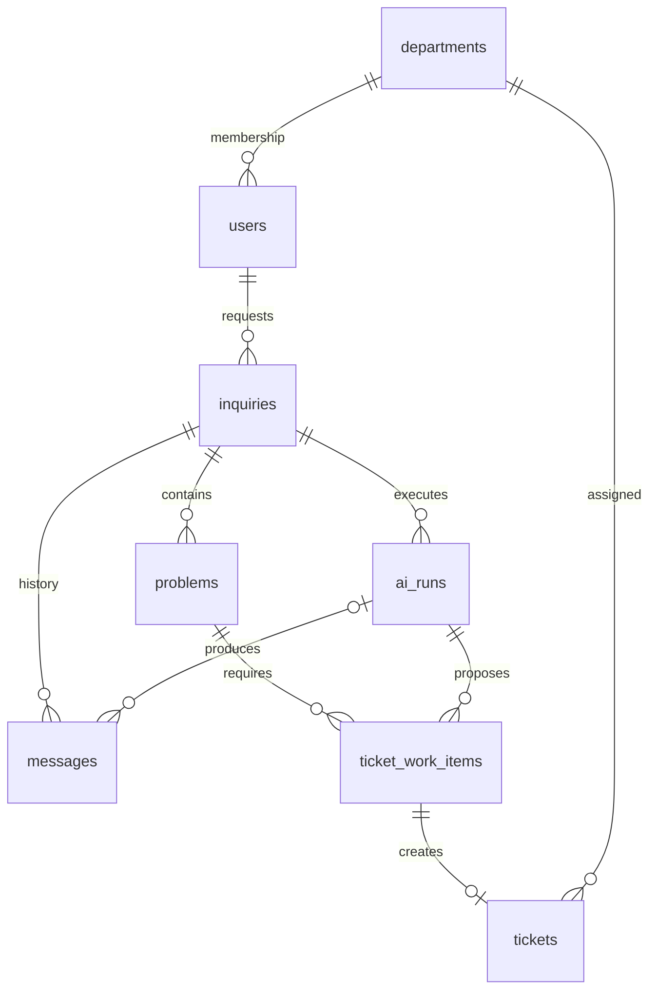

# MVP 데이터 설계 — ERD 작성 기준

[PRD](PRD.md)의 1주 MVP를 구현하기 위한 최소 논리 모델이다. 구체적인 테이블·컬럼 이름과 저장 방식은 리뷰할 설계안이며, 구현 완료를 뜻하지 않는다. 통신 형식은 [MVP API](MVP_API.md)를 함께 읽는다.

## 1. 필요한 기능과 데이터

- M1 로그인: 사용자·소속 부서·역할·세션.
- M2 문의 대화: 문의·메시지·정정 이력.
- M3 분석: 문의 안의 문제·추가 질문 횟수·AI 실행 결과.
- M4 티켓 생성: 문제별 작업 단위·복수 티켓·담당 부서.
- M5 조회: 본인 문의 상세·티켓 정보 카드·관리자 티켓 목록.
- M6 복구: 이전 실행 무효화·중복 방지·티켓별 저장 실패와 재시도.

그룹·재이관·담당자 가져오기·완료 처리·알림·통계·지식 적재는 후속 범위다. 이 문서의 상태 목록은 MVP에서 사용하는 부분집합이며 최종 제품의 상태를 삭제하는 의미가 아니다.

## 2. 기본 규칙

PostgreSQL을 사용한다. 아래 `id`는 서버가 발급하는 UUID 기본키이며, 관계 컬럼도 UUID다. 시각은 `timestamptz`, 본문은 `text`, 횟수·버전은 정수다. 별도 설명이 없는 필수 컬럼은 NULL을 허용하지 않는다. 각 테이블에 `created_at`, 변경 가능한 테이블에 `updated_at`을 둔다.

Spring이 업무 데이터 저장과 상태를 확정한다. Python은 분석 결과를 제안한다. 모델이 만든 임시 식별자를 DB 기본키로 그대로 사용하지 않는다. FK에는 업무 기록을 지우는 연쇄 삭제를 적용하지 않는다.

## 3. 업무 엔터티 8개

### departments — 부서 (M1·M4)

- `id`, `code`(고유 문자열), `name`(표시명), `active`(boolean).
- 초기 부서는 계정·권한 `ACCOUNT_PERMISSION`, 네트워크 `NETWORK`, CS `CS`, DB `DB`, Backend `BACKEND`, Frontend `FRONTEND`, 인프라 `INFRA`, 시스템 `SYSTEM`이다.
- 부서는 데이터로 관리한다. 특정 기업의 부서 수를 프로그램의 고정 enum으로 제한하지 않는다.

### users — 계정 (M1)

- `id`, `department_id`(부서 FK), `login_id`(고유 문자열), `password_hash`, `display_name`, `active`(boolean).
- `roles`(문자열 배열): MVP에서는 `EMPLOYEE`, `BUSINESS_ADMIN`, `AGENT_OPERATOR`를 사용한다. 한 계정이 여러 역할을 가질 수 있다.
- 비밀번호 원문은 저장하지 않는다. 초기 계정·부서는 seed로 준비하며 관리 화면은 만들지 않는다.

### inquiries — 문의 세션 (M2·M5)

- `id`, `requester_id`(사용자 FK), `title`, `version`(1부터 증가), `status`, `summary`(nullable), `closed_at`(nullable).
- `status`: `OPEN`(분석 접수), `WAITING_USER`(추가 답변 필요), `IN_PROGRESS`(티켓 처리로 연결), `CLOSED_NO_ACTION`(범위 밖 등 업무 조치 없이 종료).
- 티켓이 하나라도 있으면 `IN_PROGRESS`로 표시하면서 미답변 문제 수·생성 실패 수를 함께 제공한다. 티켓이 없고 추가 질문이 있으면 `WAITING_USER`, 그 외 진행 중이면 `OPEN`이다. 모든 문제가 범위 밖이며 티켓·진행 작업이 없을 때만 `CLOSED_NO_ACTION`이다.
- 사용자 메시지 추가·정정 때 `version`을 증가시킨다. AI 응답 저장 자체로는 증가시키지 않는다.

### messages — 메시지 버전 (M2)

- `id`(버전 행 PK), `message_id`(논리 메시지 UUID), `inquiry_id`(문의 FK), `revision`(1부터), `sender`(`USER` 또는 `ASSISTANT`), `content`, `run_id`(AI 실행 FK, nullable), `author_id`(사용자 FK, nullable).
- `(message_id, revision)`은 고유하다. 정정은 기존 행 덮어쓰기 대신 같은 `message_id`의 새 버전으로 추가한다. 원본과 수정 이력을 모두 남긴다.
- 메시지 표시 순서는 최초 버전 생성 시각과 `message_id`로 정하고 최신 버전을 표시한다. 정정 이력은 별도로 조회한다.
- 사용자 입력은 Unicode 코드 포인트 기준 4,000자 이하이며 공백만 있는 입력은 거부한다. AI 답변 길이에 같은 제한을 자동 적용하지 않는다.

### problems — 문의 안의 문제 (M3)

- `id`, `inquiry_id`(문의 FK), `summary`, `category`(nullable), `status`, `question_count`(0~3).
- `category`: `ACCOUNT_AUTH`, `PERMISSION`, `NETWORK_ACCESS`, `SOFTWARE`, `BUSINESS_SERVICE_ERROR`, `OTHER`.
- `status`: `ANALYZING`, `WAITING_USER`, `READY_FOR_TICKET`, `TICKETED`, `OUT_OF_SCOPE`.
- 최대 3회의 추가 질문은 문제 단위로 센다. 같은 질문의 재전송은 횟수에 더하지 않는다. 한 응답에 여러 질문 문장이 있어도 해당 문제에 대한 한 번의 추가 질문 요청으로 센다.
- 판별하기 어려운 IT 문제는 CS 검토 티켓을 만든다. 시스템 오류나 모델 시간 초과를 CS 문의로 바꾸지 않는다.

### ai_runs — 실행 (M3·M6)

- `id`, `inquiry_id`(문의 FK), `inquiry_version`, `status`, `started_at`(nullable), `deadline_at`, `finished_at`(nullable), `error_code`(nullable), `result`(검증된 JSON, nullable).
- `status`: `QUEUED → RUNNING → SUCCEEDED / FAILED / TIMED_OUT`. 아직 유효한 결과를 반영하지 않은 이전 실행은 `SUPERSEDED`로 전환할 수 있다.
- 문의당 유효한 실행은 최대 하나다. 새 버전이 접수되면 이전 결과를 업무에 반영하지 않는다. 이미 만들어진 티켓은 유지한다.
- 실행 성공은 AI 결과를 받았다는 뜻이다. 모든 티켓 저장 성공과 구분한다. 모델 내부 사고 과정은 저장하지 않고 근거 요약·오류·처리 단계만 남긴다.

### ticket_work_items — 티켓 생성 작업 (M4·M6)

- `id`, `problem_id`(문제 FK), `source_run_id`(실행 FK), `source_inquiry_version`, `work_scope`, `proposal`(검증된 JSON), `status`, `retry_count`, `next_retry_at`(nullable), `last_error_code`(nullable).
- `status`: `PENDING → SUCCEEDED` 또는 `RETRY_WAIT → PENDING`. 재시도 소진은 `NEEDS_REVIEW`, 아직 저장되지 않은 이전 버전 작업은 `SUPERSEDED`다.
- 문제 하나에 필요한 작업 단위가 여러 개일 수 있다. 티켓 수에 고정 상한을 두지 않는다. 재실행·재시도는 기존 작업 ID를 유지한다.
- 실패한 작업을 티켓 없이 보관해야 관리자에게 누락을 보여줄 수 있다. 성공한 작업은 재생성하지 않는다.
- 일시 저장 오류는 최초 실패 후 5초, 다음 실패 후 15초에 최대 2회 재시도한다. 자동 재시도 소진 후 수동 재시도도 같은 작업 ID를 사용하며 시도 이력을 보존한다.

### tickets — 생성된 티켓 (M4·M5)

- `id`, `work_item_id`(생성 작업 FK·고유), `department_id`(부서 FK), `title`, `description`, `category`, `purpose`(`INCIDENT` 또는 `CS_REVIEW`).
- `diagnosis_summary`, `handoff_reason`, `uncertainty`(nullable), `evidence`(JSON 배열), `processing_status`, `routing_status`.
- MVP 생성 시 `processing_status=WAITING`, `routing_status=ASSIGNED`다. 개인 담당자와 완료 변경 API는 이번 범위에서 필요하지 않다.
- 문의·문의자는 생성 작업 → 문제 → 문의 관계로 확인한다. 조회용 중복 FK를 추가한다면 원본 관계와 일치를 검사해야 한다.
- 근거는 메시지 ID·버전·요약을 담는다. 추론을 확정된 원인으로 기록하지 않는다.

## 4. 관계 초안

컬럼을 포함한 그림과 각 테이블의 필요성은 [MVP ERD](MVP_ERD.md)에서 확인한다.

## 5. 업무 테이블 외에 필요한 저장

이 정보도 복구에 필요하지만 별도 업무 화면을 만들지는 않는다. 사용하는 세션 라이브러리와 저장소가 결정되면 물리 ERD에 포함한다.

- **세션:** 세션 식별자의 안전한 저장값, 사용자, 생성·마지막 사용자 활동·만료·무효화 시각. 유휴 60분·최대 8시간이다. WS 연결 유지나 자동 조회는 활동이 아니다.
- **멱등 요청:** 사용자·메소드·경로·키, 요청 해시, 처리 상태, 응답 코드·본문, 만료 시각. 응답 캐시는 최초 접수부터 24시간이다. 만료 후에도 `tickets.work_item_id`의 유일성은 유지한다.
- **AI 이벤트 수신:** 고유 `event_id`, `run_id`, 요청 해시, 수신·처리 결과. 동일 이벤트 중복 수신으로 메시지·질문 횟수·티켓이 늘어나지 않게 한다.
- **업무 시도 이력:** 작업 ID, 시도 번호, 자동/수동, 요청자, 시작·종료·오류 코드. 마지막 오류만 덮어써서 복구 이력을 잃지 않는다.

## 6. 반드시 지킬 저장·조회 규칙

1. 문의와 첫 메시지는 함께 저장한다. 실행 접수 상태도 영속화해 서버 재시작 뒤 누락을 찾을 수 있게 한다.
2. 티켓 한 건·부서 배정·작업 성공 처리는 같은 트랜잭션이다. 여러 티켓 전체를 하나의 취소 단위로 묶지 않는다.
3. 결과 반영 직전에 문의 버전을 잠금 또는 조건부 갱신으로 확인한다. 버전 확인 후 저장 사이에 정정이 끼어들 수 없게 한다.
4. FK와 별개로 문제·실행·작업이 같은 문의에 속하는지 검사한다. 다른 문의의 ID를 끼워 넣는 요청을 거부한다.
5. 문의자는 본인 문의를 조회한다. 현재 배정 부서 구성원은 해당 티켓과 관련 대화만 조회한다. 업무 관리자는 전체 티켓, 운영 관리자는 실행·복구 정보를 역할 범위에서 조회한다.
6. MVP에 삭제 API는 만들지 않는다. 업무 기록은 연결 업무가 모두 종료된 마지막 시점부터 180일, 운영 로그는 생성 후 30일 보존한다. 미해결·복구 대기는 만료시키지 않는다.

권장 초기 인덱스는 문의의 `(requester_id, updated_at)`, 메시지의 `(inquiry_id, created_at)`, 티켓의 `(department_id, created_at)`, 작업의 `(status, next_retry_at)`, 실행의 `(inquiry_id, inquiry_version)`이다. 정확한 길이 제한·인덱스·세션 테이블은 마이그레이션 작성 때 확정한다.
