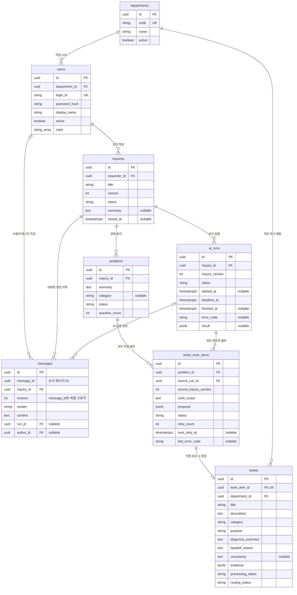

# MVP ERD와 테이블 역할

[MVP 데이터 설계](MVP_DATA.md)를 그림으로 풀어 쓴 논리 ERD다. 업무 테이블 8개를 대상으로 하며, 실제 DDL이나 마이그레이션 적용 결과는 아니다. API 구현에는 [MVP API](MVP_API.md)를 함께 참고한다.

## 1. 전체 관계와 컬럼

`PK`는 기본키, `FK`는 외래키, `UK`는 고유키다. `||`는 정확히 1개, `o|`는 0~1개, `o{`는 0개 이상을 뜻한다. nullable 주석이 없는 업무 컬럼은 필수다.

그림의 `string`은 문자열, `string_array`는 문자열 배열, `jsonb`는 JSON 저장 타입을 표현한다. 문자열의 실제 길이와 CHECK 제약은 물리 설계에서 구체화한다. 모든 테이블의 공통 `created_at`과 변경 가능한 테이블의 `updated_at`은 가독성을 위해 그림에서 생략했다.

## 2. 각 테이블이 필요한 이유

### departments — 누가 처리할 것인가

직원의 소속과 티켓을 받을 부서를 관리한다. 부서 이름을 티켓마다 직접 적으면 이름 변경이나 오타로 조회·권한 검사가 달라질 수 있어 공통 ID를 참조한다.

부서 하나에 여러 사용자와 티켓이 연결된다. **문의자의 소속 부서와 티켓의 처리 부서는 서로 다를 수 있다.** Frontend 소속 직원이 VPN 문제를 문의하면 티켓은 네트워크 부서로 간다.

### users — 누가 문의하고 조회하는가

로그인 계정, 소속, 역할을 저장한다. 본인 문의 조회와 부서 티켓 조회, 관리자 접근의 기준이다. 한 사용자는 여러 문의를 작성할 수 있다.

MVP에서는 한 사용자가 하나의 부서에 소속되고 역할은 여러 개 가질 수 있다. 개인 담당자 배정은 이번 ERD에 포함하지 않으므로 티켓에 담당자 FK는 없다.

### inquiries — 하나의 상담을 묶는 단위

채팅 세션 하나를 문의 하나로 저장한다. 문의 상세에서 대화·분리된 문제·생성된 여러 티켓을 모아 보여주기 위한 중심 테이블이다.

`version`은 사용자가 메시지를 추가하거나 정정했을 때 증가한다. 이전 내용으로 실행 중인 AI가 뒤늦게 응답해도 최신 문의에 반영하지 않도록 비교한다.

### messages — 무엇을 말했고 어떻게 정정했는가

사용자 질문과 AI 답변, 정정 전후 내용을 보관한다. 티켓의 진단 근거를 원래 대화까지 추적할 수 있다.

`id`는 저장 행마다 다르다. `message_id`는 같은 메시지의 여러 버전을 묶는 ID다. 예를 들어 하나의 질문을 정정하면 같은 message_id로 revision 1과 2를 보존한다. `(message_id, revision)`에 고유 제약을 둔다.

사용자 메시지는 author_id로 작성자를, AI 답변은 run_id로 생성 실행을 추적한다. 따라서 두 FK는 전체 테이블 관점에서 nullable이다. 사용자 메시지의 작성자와 AI 답변의 실행 출처는 각각 서버에서 검증한다.

### problems — 한 문의에서 무엇이 문제인가

“VPN도 안 되고 포털 데이터도 안 보여요”라는 한 문의에서 서로 다른 두 문제를 분리한다. 문제마다 분류·진행 상황·추가 질문 횟수가 달라질 수 있으므로 문의 테이블에 한 개의 분류만 두면 부족하다.

문의 하나에 문제 여러 개가 속하고, 문제 하나에서 필요한 티켓 생성 작업이 여러 개 나올 수 있다. 아직 분석 전인 문의에는 문제가 없을 수도 있다.

### ai_runs — 어떤 내용으로 분석했고 성공했는가

AI 호출의 접수·실행·실패·시간 초과와 결과를 추적한다. 같은 문의도 추가 답변·정정·재시도 때문에 여러 번 실행되므로 문의와 실행을 분리한다.

`inquiry_version`은 실행에 사용한 문의 버전이다. AI 실행 성공과 티켓 저장 성공은 다르다. 실행은 성공했어도 뒤의 티켓 저장이 실패할 수 있다. 모델 내부 사고 과정 대신 검증된 결과와 근거 요약을 저장한다.

### ticket_work_items — 아직 티켓이 없어도 해야 할 일을 보존

AI가 제안한 티켓 생성 작업을 실제 티켓과 분리해 저장한다. 티켓 저장에 실패하면 tickets에는 행이 없으므로, 이 테이블이 없을 경우 무엇을 다시 시도해야 하는지 잃어버린다.

작업 하나에서 티켓은 최대 한 개만 생성된다. 저장 전·실패 중에는 티켓이 없고 성공하면 하나가 연결된다. `tickets.work_item_id`의 고유 제약으로 같은 작업의 중복 생성을 막는다.

재시도는 같은 작업 ID를 사용한다. source_run_id는 현재 저장 제안의 출처이며 전체 재시도 이력을 대신하지 않는다. 새 분석으로 제안을 갱신할 때도 별도 시도 이력에 변경 출처를 남겨야 한다.

### tickets — 실제로 생성·배정된 업무

담당 부서가 조회할 업무와 진단 근거를 저장한다. 유효한 부서가 지정되고 저장에 성공한 결과만 이 테이블에 들어온다. MVP에서는 처리 대기 `WAITING`, 배정 완료 `ASSIGNED`로 생성된다.

문의자는 `tickets → ticket_work_items → problems → inquiries → users`로 확인한다. 문의 ID나 문의자 ID를 티켓에 중복 저장하지 않아도 관계를 따라 조회할 수 있다.

## 3. 예시로 보는 데이터 연결

직원 한 명이 “VPN 연결이 안 되고 업무 포털 데이터 조회도 실패합니다”라고 문의한 경우다.

1. inquiries에 문의 1개, messages에 질문을 저장한다.
2. ai_runs에 이번 문의 버전의 실행을 기록한다.
3. problems에 VPN 접속 문제와 포털 데이터 조회 문제를 분리한다.
4. VPN 문제는 네트워크 조사 작업을 만든다. 포털 문제는 근거에 따라 DB 조사와 Backend 조사 작업을 각각 만들 수 있다.
5. ticket_work_items의 각 작업을 검증해 tickets로 생성하고 담당 부서를 연결한다. 이 예시에서는 문의 1개 → 문제 2개 → 작업 3개 → 티켓 최대 3개다. 항상 3개를 만든다는 규칙은 아니다.
6. 세 작업 중 하나의 저장만 실패하면 성공한 티켓 2개는 유지한다. 실패 작업만 재시도하고 소진 시 관리자 확인 대상으로 남긴다.

## 4. ERD 외에 구현할 제약

- `messages(message_id, revision)`과 `tickets(work_item_id)`는 고유해야 한다.
- 같은 논리 메시지의 모든 버전은 같은 문의에 속해야 한다.
- 작업의 problem_id와 source_run_id가 가리키는 문의는 같아야 한다. 각각의 FK 존재 여부만 검사해서는 이 조건을 보장할 수 없다.
- 현재 실행 결과를 반영할 때 문의 version을 다시 검사한다. 버전 검사와 저장 사이의 동시 정정도 잠금 또는 조건부 갱신으로 막는다.
- 티켓 저장·부서 배정·작업 성공 변경은 한 트랜잭션으로 처리한다. 다른 작업의 실패 때문에 이미 성공한 티켓까지 취소하지 않는다.
- 문제가 여러 작업을 포함하면 하나만 성공했다고 전체 문제를 완료로 해석하지 않는다. 세부 작업 상태를 함께 조회한다.
- JSON 안의 메시지 근거 참조는 일반 FK가 자동 검증하지 못한다. Spring에서 메시지 소속과 버전을 검사한다.
- FK 삭제 정책은 업무 이력을 연쇄 삭제하지 않도록 설정한다.

## 5. 그림에 포함하지 않은 저장 영역

이 ERD는 **업무 테이블 8개의 그림이지 전체 물리 DB가 8개라는 뜻은 아니다.** 세션, 멱등 응답 캐시, AI 이벤트 수신 기록, 업무 시도 이력은 [데이터 문서의 보조 저장 항목](MVP_DATA.md#5-업무-테이블-외에-필요한-저장)에 따라 필요하다. 세션 라이브러리와 저장 방식이 정해지면 물리 ERD에 별도로 추가한다.

그룹·재이관·개인 담당자·알림·통계·지식 검색 저장소는 이번 MVP 그림에 포함하지 않았다. 후속 기능을 시작할 때 관계를 확장한다.
